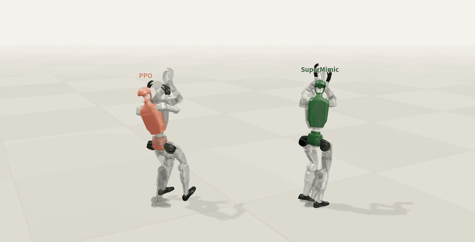
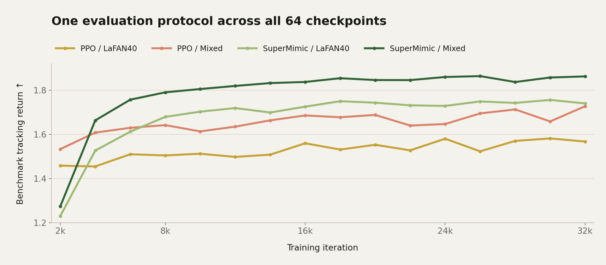

# SuperMimicLite

G1 motion tracking with MimicLite and Uni-SuperMimic. Includes PPO and
SuperMimic training, pretrained policies, ONNX export, and a fixed
228-motion evaluation.

[Models](https://huggingface.co/han-xudong/SuperMimicLite) ·
[Data](https://huggingface.co/datasets/han-xudong/SuperMimicLite) ·
[Training](docs/TRAINING.md) · [Evaluation](docs/EVALUATION.md)

## Demo

<p align="center">
  
</p>

Coral: PPO. Green: SuperMimic. Gray: reference motion. Frames after the first
failure are illustrative and excluded from the tracking score.

## Results

| Policy | Method | Data | Body ↓ mm | Wrist ↓ mm | Root ↓ m | Completed / 228 |
|---|---|---|---:|---:|---:|---:|
| P-L | PPO | LaFAN40 | 40.22 | 62.61 | 1.479 | 120 |
| P-M | PPO | Mixed | 40.50 | 56.21 | 0.911 | 136 |
| S-L | SuperMimic | LaFAN40 | 43.22 | 65.55 | 0.737 | 182 |
| S-M | SuperMimic | Mixed | **32.47** | **42.37** | **0.511** | **198** |

Body and wrist errors average the Locomotion80 and Manipulation48 subset
means equally. Root error uses Locomotion80. Completion counts all 228
motions before the first failure. See [per-motion results](reference/per-motion.json)
and the [evaluation protocol](docs/EVALUATION.md).



## Downloads

Final 32k policies and native checkpoints are hosted on
[Hugging Face](https://huggingface.co/han-xudong/SuperMimicLite).

| Policy | ONNX policy | Native checkpoint |
|---|---|---|
| P-L | [P-L.onnx](https://huggingface.co/han-xudong/SuperMimicLite/resolve/main/models/P-L.onnx?download=true) | [P-L.pt](https://huggingface.co/han-xudong/SuperMimicLite/resolve/main/checkpoints/P-L.pt?download=true) |
| P-M | [P-M.onnx](https://huggingface.co/han-xudong/SuperMimicLite/resolve/main/models/P-M.onnx?download=true) | [P-M.pt](https://huggingface.co/han-xudong/SuperMimicLite/resolve/main/checkpoints/P-M.pt?download=true) |
| S-L | [S-L.onnx](https://huggingface.co/han-xudong/SuperMimicLite/resolve/main/models/S-L.onnx?download=true) | [S-L.pt](https://huggingface.co/han-xudong/SuperMimicLite/resolve/main/checkpoints/S-L.pt?download=true) |
| S-M | [S-M.onnx](https://huggingface.co/han-xudong/SuperMimicLite/resolve/main/models/S-M.onnx?download=true) | [S-M.pt](https://huggingface.co/han-xudong/SuperMimicLite/resolve/main/checkpoints/S-M.pt?download=true) |

The [data hub](https://huggingface.co/datasets/han-xudong/SuperMimicLite)
hosts LaFAN40 and the public non-SONIC portions of Mixed: 3,692 exact training
motion files, plus the complete [228-motion evaluation set](https://huggingface.co/datasets/han-xudong/SuperMimicLite/tree/main/evaluation).
Selection metadata, source references, and original terms are retained. SONIC
motions and sequences containing SONIC segments are obtained separately under
their source terms.
The commands below use pinned revisions and verify SHA256 hashes.

## Setup

Requires Linux, Git, and [uv](https://docs.astral.sh/uv/).

```bash
git clone https://github.com/han-xudong/SuperMimicLite.git
cd SuperMimicLite
uv sync --locked
uv run scripts/bootstrap.py
uv run scripts/fetch.py all --checkpoints
```

This downloads the four ONNX policies to `models/`, native checkpoints to
`checkpoints/`, evaluation motions to `data/motiondecode/`, and the robot asset.
Training data is prepared separately below.

## Evaluate

```bash
# One complete motion per policy.
uv run scripts/smoke.py --out outputs/smoke-01

# All four policies on 228 motions, then recompute metrics.
uv run scripts/evaluate.py --out outputs/benchmark-01 --workers 4
uv run scripts/report.py --input outputs/benchmark-01/evaluation --out outputs/report-01
```

## Train

```bash
uv run scripts/bootstrap.py --training
uv run scripts/fetch.py asset --training-asset
uv run scripts/training_data.py prepare --root data/training --data L
bash scripts/train.sh --cell S-L --data data/training --out outputs/train-S-L-01
```

Use `P-L`, `P-M`, `S-L`, or `S-M` to select a recipe. Training uses a separate
Python 3.12 environment. For `P-M` or `S-M`, prepare the full mixture
with `--data M` and licensed BONES-SEED CSVs as described in the
[training guide](docs/TRAINING.md), which also covers configuration and export.

## License

SuperMimicLite's original code is licensed under [Apache-2.0](LICENSE).
Third-party code, model assets, weights, and motion data retain their own
terms; see [NOTICE](NOTICE) and [THIRD_PARTY.md](THIRD_PARTY.md).

## Acknowledgments

Built on [MimicLite](https://github.com/EGalahad/mimic-lite),
[Uni-SuperMimic](https://github.com/Motphys/Uni-SuperMimic), and
[SuperMimic](https://supermimic.github.io/).
See [THIRD_PARTY.md](THIRD_PARTY.md) for source revisions and licenses.

Training data includes [Motion Data by Bones Studio](https://bones.studio/).
Use of the underlying dataset is subject to the
[BONES Motion Capture Dataset License Agreement](https://huggingface.co/datasets/bones-studio/seed/blob/main/LICENSE.md).
